# Job Search: resume-matched jobs from LinkedIn, Naukri and Indeed

Upload your resume and get the **latest jobs that fit you**, ranked by an AI match score, with
**matching and missing skills** for every job. It runs **on your own computer**: a local web page
drives a real browser (Playwright) through LinkedIn, Naukri and Indeed, and OpenAI reads your resume
and scores each job.


https://github.com/user-attachments/assets/533608e4-3862-4822-bb7c-f1f81f2b237c


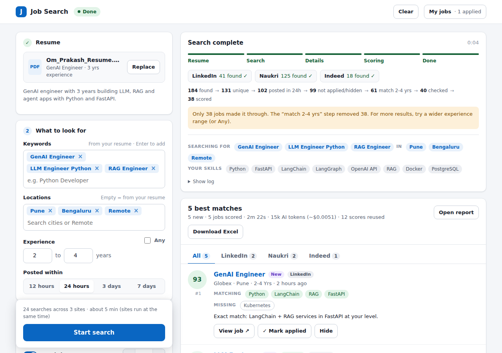

> Screenshots in this guide use sample data.
>
> **New here?** Follow [QUICKSTART.md](QUICKSTART.md): every step from installing Python to your first search.

**What it does for you**

- Reads your resume and fills in keywords, city and an experience range automatically
- Searches LinkedIn, Naukri and Indeed **at the same time**, only recent posts (12 h to 7 days)
- Scores every job 0-100 against your resume and explains why (matching / missing skills)
- Remembers jobs you **applied to** or **hid**, and can show **only new** jobs
- Runs **every day at a time you choose**, even when the page is closed
- Keeps your page as it was after a reload or restart, until you press **Clear**
- Saves work it already did (job details, AI scores, resume reading), so repeat runs are faster and cheaper

---

## Contents

1. [Install (one time)](#1-install-one-time)
2. [Start the app](#2-start-the-app)
3. [How to use the website, step by step](#3-how-to-use-the-website-step-by-step)
4. [Tips and troubleshooting](#4-tips-and-troubleshooting)
5. [Settings in `.env`](#5-settings-in-env)
6. [Command line (optional)](#6-command-line-optional)
7. [Where your data is stored](#7-where-your-data-is-stored)
8. [For developers](#8-for-developers)

Want to help? See [CONTRIBUTING.md](CONTRIBUTING.md) for the branch workflow and coding rules.

---

## 1. Install (one time)

You need **Python 3.10+**, **Node.js 20+** (for the web page), **Git** and an **OpenAI API key**.

```bash
git clone https://github.com/pattjoshi/playwright-python-job-search.git
cd playwright-python-job-search

python -m venv .venv
# Windows:      .venv\Scripts\activate
# macOS/Linux:  source .venv/bin/activate

pip install -r requirements.txt      # the backend (Python) and its packages
playwright install chromium          # the browser that searches the job sites

cd frontend
npm install                          # the web page's packages
npm run build                        # builds the page into frontend/out
cd ..

# Windows: copy .env.example .env      macOS/Linux: cp .env.example .env
```

Open `.env` in a text editor and paste your key:

```ini
OPENAI_API_KEY=sk-...
```

`.env` is never uploaded to GitHub, so your key stays on your computer.

## 2. Start the app

```bash
python -m job_search
```

On Windows you can also just **double-click `start_ui.bat`** (macOS/Linux: `./start_ui.sh`). It builds the
page the first time if needed.

Your browser opens **http://127.0.0.1:8000**. Keep the terminal window open while you use the page;
press **Ctrl+C** in it to stop the app. The page only works on your computer (it isn't on the internet).

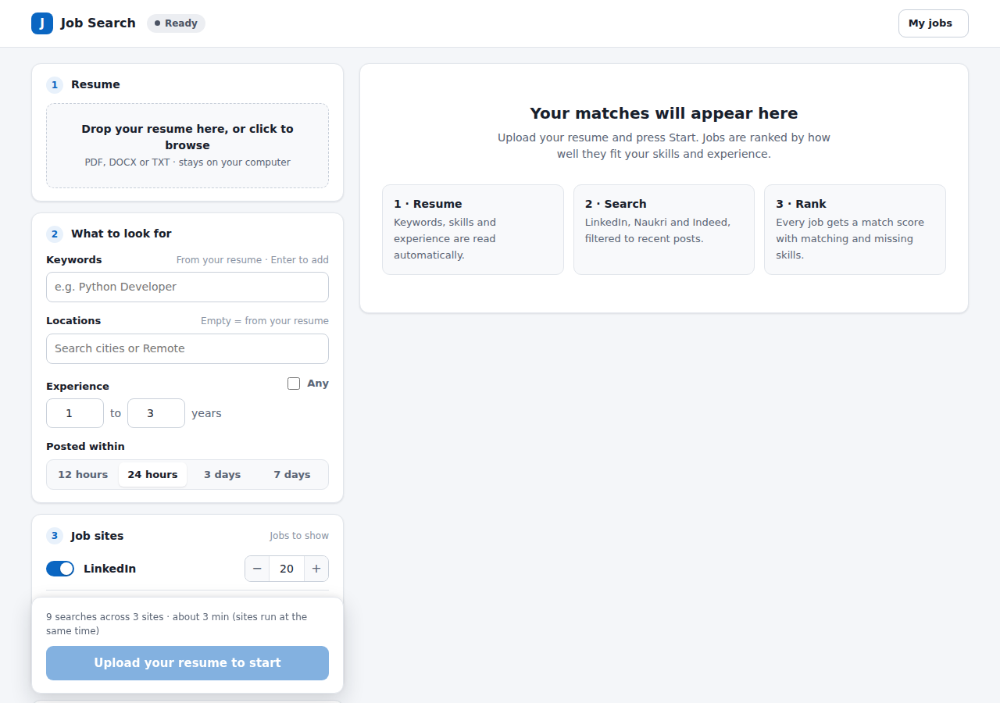

---

## 3. How to use the website, step by step

**First time:** the page asks you to **create your account** (name, email, password). It protects your resume,
jobs and history on this computer. Next time you just **sign in**. Forgot the password? In the project folder run
`python -m job_search reset-password --email you@example.com`.

`http://127.0.0.1:8000` shows the **home page**; click **Get started** or **Open dashboard**. After signing in, the app opens on the **Dashboard** (your counts, the latest matches, the daily search and recent searches).
Use the **sidebar** to move between pages; the light/dark switch is at the top right.

Open **Search jobs** in the sidebar. The **left side** is where you set up the search; the **right side** shows
progress and results. A running search keeps going if you open another page: the top bar shows a timer, and
a message pops up when it's done.

### Step 1 · Upload your resume

1. **Drag your resume** onto the box, or click it and choose the file (**PDF, DOCX or TXT**).
2. Wait a few seconds while the AI reads it.
3. The card shows your file name, current title, years of experience and a one-line summary.

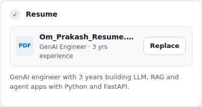

- **Same resume again?** The AI reading is reused: no extra AI cost.
- **After a reload or app restart** the resume is still there (a green note says it was restored).
  You don't need to upload it again.
- To use a different resume, click **Replace**.

### Step 2 · What to look for

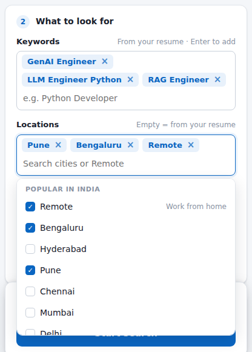

1. **Keywords**: filled in from your resume as 6–10 short job titles: your main title plus the other names
   the same job is posted under (for example *GenAI Engineer*, *LLM Engineer*, *AI Engineer*), so you don't miss
   posts. Type a new one and press **Enter** to add it; click **×** to remove one. Keep them to short job titles:
   Naukri wants every word to match, so "GenAI Engineer Python FastAPI LangChain" finds almost nothing (the page
   warns you). Your skills are used for scoring, not searching. Fewer keywords = faster search.
2. **Locations**: click the box and pick one or more cities, or **Remote** (work from home).
   Type to filter (e.g. `hyd` + **Enter** picks Hyderabad). You can also type any other city and choose
   **Add "…"**. Leave it empty to use the city from your resume.
3. **Experience**: e.g. **2 to 4** years. Jobs asking for clearly more or less are filtered out.
   Tick **Any** to switch this off.
4. **Exclude companies**: type a company and press **Enter** (or several with commas, e.g. `TCS, Wipro`). Their
   jobs are left out of every search, the daily search and the results on screen. "Infosys Ltd" and "INFOSYS" count
   as the same company. It's the same list as **Hide this company** in the results, so a company you hide there
   shows up here too; click **×** to show its jobs again.
5. **Posted within**: **12 hours**, **24 hours**, **3 days** or **7 days**.

### Step 3 · Job sites and how many jobs to show

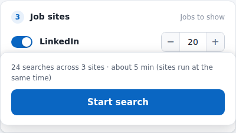

- Turn each site **on or off** with its switch.
- Use **− / +** (or type) to choose **how many jobs to show from that site** (1-100),
  e.g. LinkedIn 20, Naukri 12, Indeed 10.

### Step 4 · Options

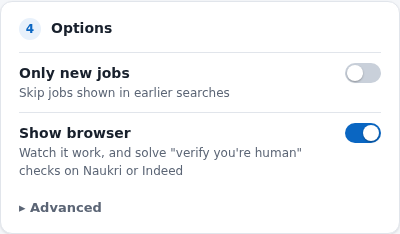

- **Only new jobs**: skip jobs you were already shown in earlier searches.
- **Show browser**: watch the search happen. Keep this **on** if Naukri or Indeed ask you to
  "verify you're human": you can solve it in the browser window and the search continues.
- **Advanced**:
  - *Pages per search*: how deep to look on each site (default 3).
  - *Jobs to score per site*: how many jobs the AI checks per site (default 40). Higher = slower and a bit more cost.
  - *Forget seen jobs*: makes previously shown jobs count as new again (applied/hidden jobs stay).

### Step 5 · Start, watch, stop

1. Check the estimate above the button (e.g. *"24 searches across 3 sites · about 5 min"*).
2. Click **Start search**.
3. Watch the progress card: the steps (**Resume → Search → Details → Scoring → Done**), each site's
   status and how many jobs it found, and a timer.
4. Click **Stop search** at any time to cancel.

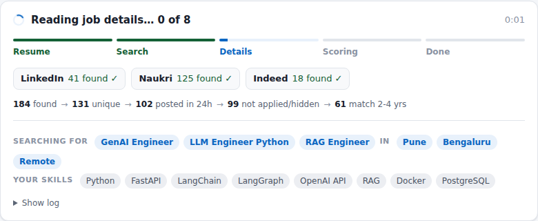

The line of numbers is the **funnel**: how many jobs were left after each filter, e.g.
`184 found → 131 unique → 102 posted in 24h → 61 match 2-4 yrs → 38 scored`. If you get fewer jobs than
you asked for, a yellow hint tells you which filter removed the most and what to change.

### Step 6 · Read the results

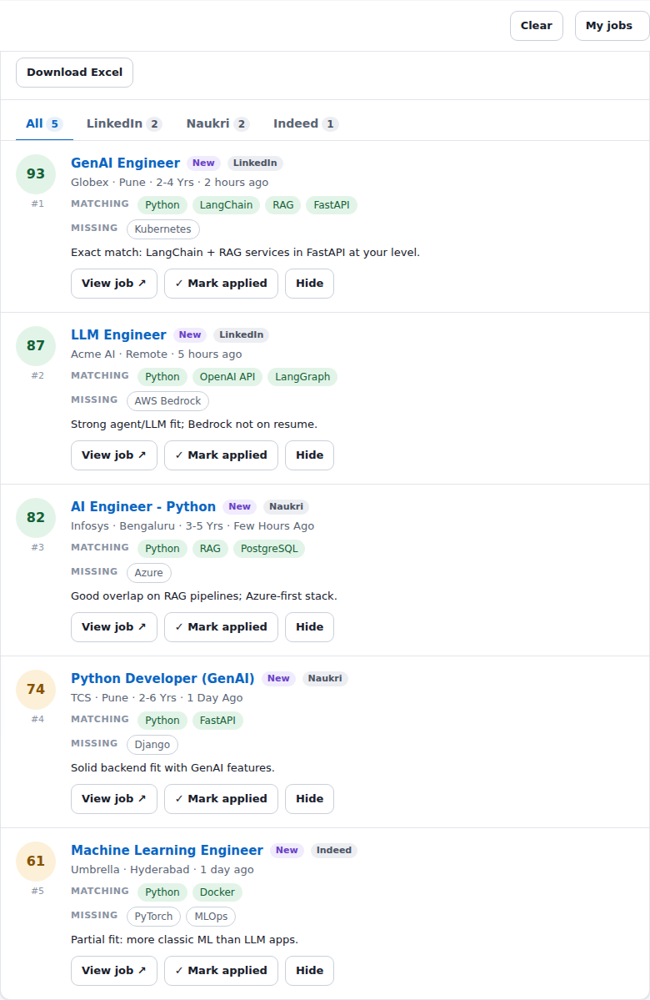

- The header shows how many jobs are new, the run time, AI tokens used (and cost, if configured) and how
  many scores were reused from earlier runs.
- **Tabs**: **All** (best matches from every site) or one site at a time.
- **Filters** (no new search needed): type words to match the title, company or location, pick a minimum score
  (60+ / 70+ / 80+) or how recently it was posted, and sort by **Best match**, **Newest** or **Company A–Z**.
  The line under them says how many jobs the filters left out; **Clear** shows them all again.
- Each job card shows:
  - the **match score** (green 75+, yellow 50-74, grey below 50)
  - title, company, location, required experience, when it was posted
  - a **New** badge if you haven't seen it before
  - **Matching** skills (green) and **Missing** skills
  - a one-line reason for the score
- Buttons on each job:
  - **Details**: opens a side panel with the job description, the AI's reason, matching and missing skills,
    and the same actions, plus **Hide this company**
  - **View job ↗**: opens the job on the site, where you apply
  - **Track**: adds the job to **Applications** as *Saved*, so you can follow it there
  - **✓ Mark applied**: tracks it in *My jobs* and *Applications* (as *Applied*) and never shows it again
  - **Hide**: never show this job again (**Undo** is right there)
- **Hide this company** (in Details) removes that company's jobs from the results and from every future search
  ("Acme Pvt Ltd" and "ACME" count as the same company). **Hidden companies (n)**, next to the filters, lists them
  so you can show one again.
- **Open report** opens the same results as a standalone HTML page; **Download Excel** gets every scored job.

### Step 7 · My jobs and search history

On the **Search jobs** page, click **My jobs** (top right of the page).

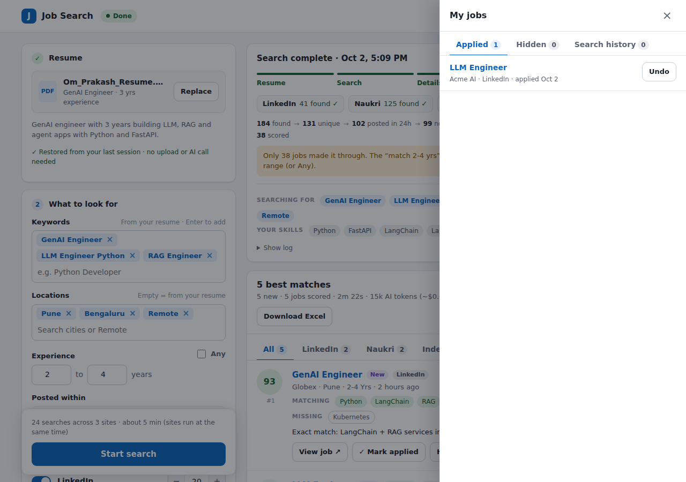

- **Applied** and **Hidden** tabs list those jobs with links and dates. **Undo** moves a job back.
- **Search history** lists every search (manual and daily): status, time taken, jobs found per site,
  how many were shown/new, tokens and cost, the funnel, any error, and a link to its report.

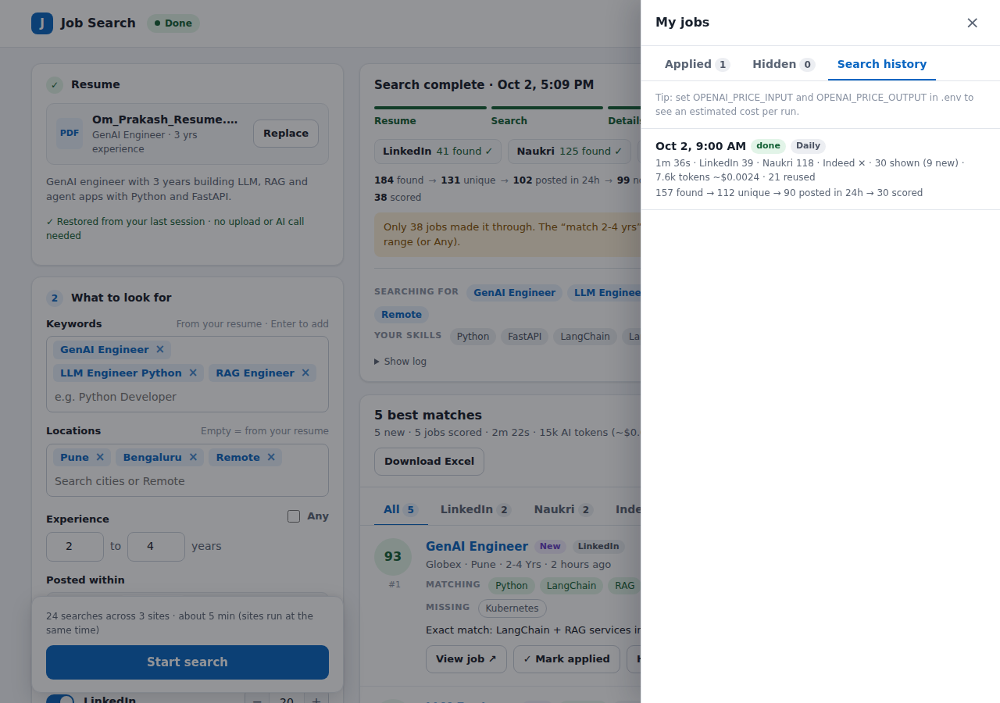

### Step 8 · Daily search (automatic)

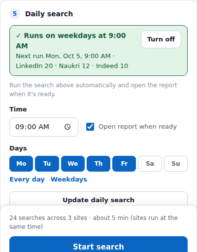

1. Set up the search above the way you like it (resume, keywords, cities, sites…).
2. In **Daily search**, choose a **time** (e.g. 9:00 AM) and the **days** (or click **Every day** / **Weekdays**).
3. Click **Save daily search**.

- It runs through **Windows Task Scheduler** (cron on macOS/Linux), so it works **even when the page is
  closed**. If the laptop was off or asleep at that time (Windows), it runs as soon as it's back on.
- When it finishes, the report opens in your browser (untick *Open report when ready* if you don't want that).
- The card shows the next run, the last run with a link to its report, and a **Turn off** button.
- Changed your settings? Click **Update daily search**.
- Test it without waiting: `python -m job_search daily` (log: `data/scheduled.log`).

### Step 9 · Reload, restart and Clear

- **Reloading the page or restarting the app keeps everything**: your resume, keywords, the last search's
  progress and results (including jobs you marked applied).
- Click **Clear** (top right of the Search jobs page) to remove the **resume, keywords and results** from the page.
  It asks you to confirm first. **Your settings, applied/hidden jobs, search history and daily search are kept.**

### Step 10 · Track your applications

Click **Applications** in the sidebar.

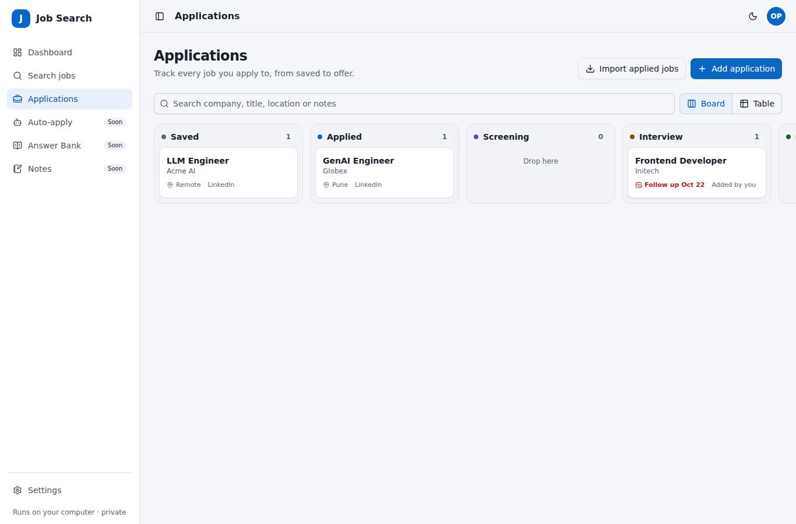

- **Board**: one column per stage (Saved, Applied, Screening, Interview, Offer, Rejected, Withdrawn).
  **Drag a card** to another column to move it (or focus it and use Space, the arrow keys and Space).
- **Table**: the same applications as rows. Click a column heading to sort, and filter by status.
- **Add application** for jobs you found elsewhere (company, role, link, location, salary, contact,
  applied and follow-up dates, notes). **Import applied jobs** adds the jobs you already marked applied.
- Click a card or row to open its **details**: change the status, open the job, see its timeline,
  **Edit** or **Delete** it.
- The **Dashboard** shows how many applications are in each stage, how many you applied to each day
  for the last two weeks, and your next **follow-ups** (overdue ones in red).

### Step 11 · Answer Bank (answers for application forms)

Click **Answer Bank** in the sidebar. These are the answers auto-apply will put into application forms.

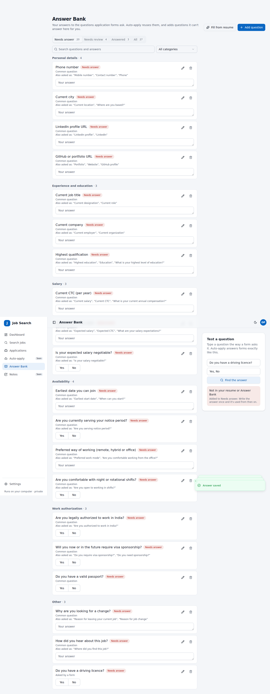

1. Click **Add common questions**: about 25 questions forms ask most (notice period, expected CTC,
   relocation, work authorization…). If your resume is on the Search jobs page, the AI fills in what your
   resume says (name, email, experience, skills).
2. **Needs review**: answers the AI wrote. Check each one and click **Approve**, or change it and **Save answer**.
3. **Needs answer**: questions only you can answer (salary, notice period…). Write the answer once.

How a form question gets its answer:

| The question is… | What happens |
|---|---|
| One you saved, in any wording you saved | Your answer is used |
| Worded differently ("How soon can you join?" for "Notice period") | The AI recognises it, uses your answer and remembers that wording |
| Not saved, but your resume answers it | The AI drafts an answer from your resume; it goes to **Needs review** |
| Not in your resume or the bank | **The AI never guesses.** It's added to **Needs answer** for you to write |

- **Test a question** (right side) shows exactly what auto-apply will do with any question.
- Click the pencil to change a question, its category, its answer type (text, number, Yes/No, options) and the
  **other wordings** forms use for it.

### Step 12 · Auto-apply (company career pages)

Click **Auto-apply** in the sidebar.

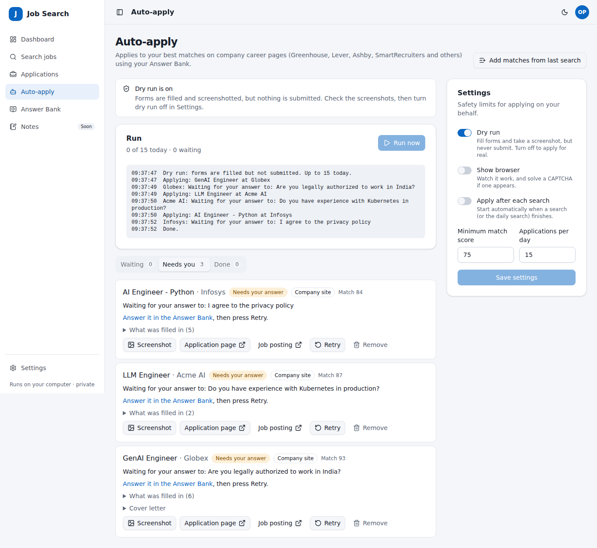

Some jobs on LinkedIn, Naukri and Indeed say **Apply on company site**. Those show a **Company site** badge in
the results. After every search (and the daily search), the ones scoring at least your **minimum match score**
(75 to start) are added to the auto-apply queue.

1. Click **Run now**. For each job, auto-apply opens the company's application page (Greenhouse, Lever, Ashby,
   SmartRecruiters or a simple company form), clicks **Apply** if needed and fills the form:
   - **Resume / CV** upload: your resume file
   - **Cover letter** and "Why do you want to join us?": written by the AI for that job, from your resume
   - **Everything else**: your Answer Bank
2. Every filled form is **screenshotted**. Open **What was filled in** on a job to see each answer.
3. **Dry run is on at first**: forms are filled but never submitted. When the screenshots look right, turn
   **Dry run** off in Settings (it asks you to confirm). Submitted jobs are added to **Applications** as Applied.

| What you see | Meaning |
|---|---|
| **Needs your answer** | A required question isn't in your resume or Answer Bank. It's added to the Answer Bank's **Needs answer** list. Answer it there, then press **Retry**. Nothing is guessed or submitted half-filled. |
| **Submitted** / **Submitted?** | Sent. "Submitted?" means no confirmation page appeared, so check your email. |
| **Do it yourself** | The site needs an account or sign-in (e.g. Workday), or showed a CAPTCHA. Turn on **Show browser** to solve CAPTCHAs while it runs. |

Safety settings: **Applications per day** (15 to start), **Minimum match score**, **Dry run**, **Show browser**, and
**Apply after each search** (off to start; turn it on for hands-free applying after each search).
#### Easy Apply on Naukri, LinkedIn and Indeed

Jobs without a company link can be applied to on the board itself, with your own account.

**Easiest: the Chrome extension.** It applies in your normal Chrome, where you're already signed in, so there's
no separate browser and no passwords. Load the `extension` folder in `chrome://extensions` (Developer mode → Load
unpacked), press **Connect extension** on the Auto-apply page, paste the key into the extension and press **Start**.
See [extension/README.md](extension/README.md).

**Or let the app use its own browser:**

1. On **Auto-apply → Settings → Job boards**, press **Sign in** next to a board. A browser window opens on that
   board's login page: log in yourself (OTP included). Auto-apply's browser stays signed in from then on
   (in `data/browser-profile`), and your password is never saved.
   *Optional:* instead, put `NAUKRI_EMAIL` / `NAUKRI_PASSWORD` (and `LINKEDIN_…`, `INDEED_…`) in `.env` and the
   app types them for you.
2. Turn on the boards you want. This also turns on **Show browser**, so you can pass a security check if one appears.
3. From the next search on, matches on those boards are queued too. They go slowly on purpose: pauses
   between steps, 20-45 seconds between applications on the same board, and at most **10 per board per day**
   (change it in Settings).

If a job doesn't go through, press **Try this job** to watch it in a visible browser, and download its
**Saved page** (the page as it was when it stopped) to send for a fix.

| Board | What happens | Dry run |
|---|---|---|
| Naukri | Clicks **Apply**, then answers the chat questions from your Answer Bank | Only checks you're signed in and Easy Apply is there (Naukri applies on the first click) |
| LinkedIn | Fills every step of the **Easy Apply** pop-up, then **Submit application** | Fills every step, then discards the pop-up |
| Indeed | **Apply now**, every page, then **Submit your application** | Fills every page, doesn't submit |

**Risk:** job boards don't allow automated applying, and LinkedIn is the strictest. An account can be warned or
restricted even at this slow pace. Start with a low daily limit and keep an eye on it.

### Step 13 · Notes

Click **Notes** in the sidebar: Notion-style pages for company research, interview prep and plans.

- **New page**, give it a title and an icon. Hover a page in the list and press **+** to put a page inside it
  (e.g. *Interview prep → Infosys → Round 1*). Use **Move to** above a page to move it, or the bin to delete it
  (the pages inside go with it).
- Type **/** in a line for the block menu, or use Markdown shortcuts at the start of a line:

| Type | Gets you |
|---|---|
| `# ` `## ` `### ` | Headings |
| `- ` | Bulleted list (Enter continues it, Enter on an empty item ends it) |
| `1. ` | Numbered list |
| `[] ` | To-do with a checkbox |
| `> ` | Quote |
| ```` ``` ```` | Code |
| `---` | Divider |

- Drag the ⋮⋮ handle to reorder blocks. **Backspace** at the start of a line turns it back into text, then joins
  it to the line above. Everything saves by itself ("Saved" at the top right).

---

## 4. Tips and troubleshooting

| What you see | What to do |
|---|---|
| **0 jobs** from a site | Check the funnel line and the yellow hint. Try more cities, fewer filters, *Any* experience or a longer *Posted within*. Click **Show log** for details. |
| **"verify you're human"** on Naukri or Indeed | Keep **Show browser** on and solve it in the browser window; the search continues. |
| **Naukri: blocked the search** (log: *Access Denied*) | Naukri refused the automated browser, so the app skipped it for that run instead of waiting on every search. Turn on **Show browser** and search again. Having Google Chrome installed helps: the app uses it when it's there. |
| A site shows **couldn't load ✕** | The site was down or blocking for now; the other sites still ran. Try again later. |
| **"OPENAI_API_KEY is not set"** | Put your key in `.env` and restart the app. |
| **"Could not read your resume"** | Use a text-based PDF or DOCX (not a scanned image). |
| **"Upload your resume first"** | Your saved resume file was cleaned up or cleared; upload it again. |
| Searches are slow | Fewer keywords or cities, fewer *Pages per search*, or a lower *Jobs to score per site*. Repeat runs are faster because work is reused. |
| Too many browser windows | That's one per site while searching in parallel. Set `PARALLEL_SITES=false` in `.env` to use one at a time. |
| Want to see the cost in $ | Add your model's prices to `.env` (`OPENAI_PRICE_INPUT`, `OPENAI_PRICE_OUTPUT`). |

**Be polite to the job sites.** The tool waits between requests, retries when a site says "too many requests",
and gives up on a site that keeps failing. Job boards restrict automated access, so keep this for
personal, low-volume use.

## 5. Settings in `.env`

The web page remembers your choices on its own. These `.env` settings are defaults (and are used by the
command line). See `.env.example` for the full list with comments.

| Setting | Default | Meaning |
|---|---|---|
| `OPENAI_API_KEY` | (required) | Your OpenAI key |
| `OPENAI_MODEL` | `gpt-5.4-mini` | Model used to read resumes and score jobs |
| `RESULTS`, `RESULTS_LINKEDIN`, `RESULTS_NAUKRI`, `RESULTS_INDEED` | 10 | Jobs shown per site |
| `LOCATION` | from resume | Cities, comma separated (`Pune, Bengaluru, Remote`) |
| `KEYWORDS` | from resume | Search phrases, comma separated |
| `EXPERIENCE` | any | Years wanted, e.g. `1-2` |
| `HOURS` | 24 | Only jobs posted within this many hours |
| `ONLY_NEW` | false | Skip jobs shown before |
| `SITES` | all | `linkedin, naukri, indeed` |
| `TOP` / `MAX_PAGES` | 40 / 5 | Jobs scored per site / result pages per search |
| `PARALLEL_SITES` | true | Search sites at the same time |
| `KEEP_DAYS` | 30 | Delete old uploads, reports and cached data after this many days (`0` = never) |
| `OPENAI_PRICE_INPUT`, `OPENAI_PRICE_OUTPUT`, `OPENAI_PRICE_CACHED_INPUT` | empty | USD per 1M tokens, to show cost per run |

## 6. Command line (optional)

Everything the page does is also available without it:

```bash
python -m job_search search --resume my_resume.pdf --location Pune Remote --experience 2-4 --results linkedin=20 naukri=12
```

Run `python -m job_search search --help` for all options. Each option matches a `.env` setting; the command line wins.

## 7. Where your data is stored

Everything stays in the project folder on your computer:

| Folder / file | What's in it | Removed by |
|---|---|---|
| `uploads/` | Resumes you uploaded | `KEEP_DAYS` cleanup (never the one in use) |
| `output/` | HTML / Excel / CSV reports | `KEEP_DAYS` cleanup (never the one on screen) |
| `data/history.sqlite3` | Your account, applications, Answer Bank, notes, auto-apply queue, applied / hidden / seen jobs and the search history | Never automatically |
| `data/auto-apply/` | Screenshots of filled application forms and the cover letters sent | When you remove the job from Auto-apply |
| `data/browser-profile/` | Auto-apply's browser, which keeps you signed in to the job boards | Delete it to sign out everywhere |
| `data/cache.sqlite3` | Saved job details, AI scores, resume readings | `KEEP_DAYS` cleanup; safe to delete anytime |
| `data/session.json` | What the page shows (resume, last results) | The **Clear** button |
| `data/search-filters.json` | Companies you hid from searches | **Hidden companies** list next to the result filters |
| `data/schedule.json`, `data/scheduled.log` | Daily search settings and its log | **Turn off** / log is trimmed when large |

Your resume text and job descriptions are sent to OpenAI for reading and scoring; nothing else leaves your computer.

## 8. For developers

The project has two parts: a **Python backend** (FastAPI + Playwright + OpenAI) and a **Next.js frontend**
(TypeScript). The frontend is exported as static files that the backend serves, so users run one command.

```
backend/                     Python package `job_search` (pip install -r requirements.txt installs it)
  src/job_search/
    api/                     FastAPI app (app.py) and one router per resource (routes/)
    cli/                     commands: serve (default), search, daily
    config/                  settings from .env, project paths, city list
    models/                  plain dataclasses: Job, Profile, SearchOptions, Schedule...
    database/                SQLAlchemy models + Alembic migrations (run automatically on start)
    repositories/            job/run history, users, applications, answers (SQLAlchemy), cache, schedule, session
    schemas/                 API errors, request validation, response serializers
    services/
      search/                the search: runner -> pipeline -> sites / filters / profile
      scraping/              one browser per site + linkedin.py, naukri.py, indeed.py
      reporting/             HTML / Excel / CSV reports
      llm_service.py         OpenAI: resume reading, parallel job scoring, token usage
      search_filters.py      companies you hid (left out of every search)
      applications.py        application tracker: validation, status changes, tracking jobs from results
      answers/               Answer Bank: starter questions, AI matching and drafts, answering form questions
      auto_apply/            auto-apply: queue rules, form reading and filling, submit + confirm, background run
      search_manager.py      runs one search at a time in the background for the web page
      schedule_service.py    daily search (Windows Task Scheduler / cron)
  tests/                     unit/ (fast) and integration/ (headless browser, fakes)
frontend/                    Next.js + TypeScript + Tailwind CSS + shadcn/ui (static export)
  src/app/(app)/             one folder per page: dashboard, search, applications, settings...
  src/components/            ui/ (shadcn/ui + small custom parts), layout/ (sidebar, top bar), one folder per feature
  src/providers/             app-wide state: config, theme, the search session (survives page changes)
  src/hooks/                 state and API calls (search form, running search, resume...)
  src/lib/                   typed API client, types, formatting, estimate, storage
  src/styles/theme.css       design tokens (colours, radius) for light and dark mode
.github/workflows/ci.yml     lint, type check, tests and build on every pull request
```

**Develop with live reload** (two terminals):

```bash
python -m job_search --no-open        # backend on http://127.0.0.1:8000
cd frontend && npm run dev            # page on http://localhost:3000 (API calls go to :8000)
```

**Checks** (the same ones CI runs):

```bash
pip install -e "./backend[dev]"
cd backend && ruff check . && pytest            # backend
cd frontend && npm run lint && npm run typecheck && npm test && npm run build   # frontend
python scripts/check_file_length.py             # every code file under 250 lines
```

**Accounts and access:** every `/api` and `/reports` request needs a signed-in user (session cookie;
`/api/auth/*` is the only public part). Owner-only actions use `require_owner(request)` from `api/auth.py`.

**Database changes:** edit `backend/src/job_search/database/tables.py`, then create a migration with
`cd backend && alembic revision --autogenerate --rev-id 0002 -m "what changed"`. The app applies it on start.

**New UI components:** shadcn/ui components are copied into `frontend/src/components/ui/`
(`npx shadcn@latest add <name>` from `frontend/`). Keep each file under 250 lines.

Tests never touch the real sites or OpenAI. To add a job board, create
`backend/src/job_search/services/scraping/<board>.py` with a class extending `BaseScraper` (implement
`search()` and, if needed, `fetch_description()`) and register it in `services/scraping/__init__.py`.
